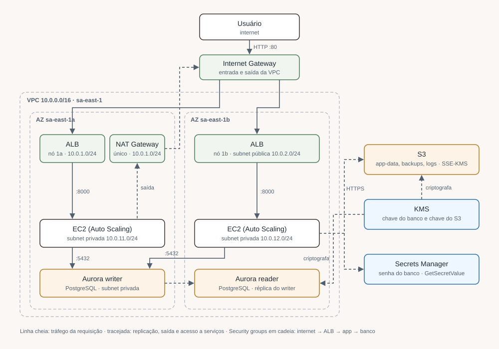
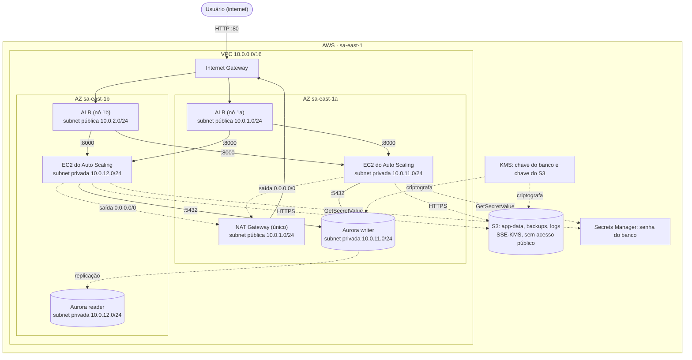

# Seguros Horizonte · Infraestrutura AWS com Terraform

[](https://github.com/Flavio-Paixao/seguros-horizonte/actions/workflows/terraform-ci.yml)

Infraestrutura de uma corretora de seguros fictícia, a **Seguros Horizonte**, construída em Terraform na região **sa-east-1 (São Paulo)**. É o Case 1 do meu portfólio de arquitetura AWS.

O objetivo é mostrar uma arquitetura de três camadas **segura e resiliente**: aplicação atrás de um load balancer, banco de dados fora da internet, tudo em **2 zonas de disponibilidade (AZs)**, com criptografia em repouso usando chaves próprias e permissões IAM de mínimo privilégio. Os dados de uma corretora são dados pessoais de clientes, então as decisões seguem a lógica da LGPD: dados no Brasil, criptografados e acessíveis só por quem precisa.

> **Status:** as 7 fases estão no `main`. O código foi validado com `terraform validate` e `terraform plan` (**69 recursos**) e passa por CI em todo PR (formato, validação, tflint e checkov). **Nunca foi executado `terraform apply`**: o projeto existe para estudo e portfólio, e nada disso está rodando numa conta AWS.

## Documentação

| Documento | Conteúdo |
|---|---|
| [README.md](README.md) | Visão geral, diagrama, estrutura e como validar (este arquivo) |
| [docs/ARCHITECTURE.md](docs/ARCHITECTURE.md) | Cada camada em detalhe: rede, IAM, KMS, Aurora, ALB/ASG e S3 |
| [docs/DECISIONS.md](docs/DECISIONS.md) | Cada decisão com o porquê, as alternativas descartadas, o trade-off e as pendências conhecidas |
| [docs/COST-ANALYSIS.md](docs/COST-ANALYSIS.md) | Custo mensal estimado em sa-east-1, por serviço, opções de redução e custo de um teste de poucas horas |

## Diagrama




Leitura rápida do caminho de uma requisição:

1. O usuário chega no **ALB** (nas 2 subnets públicas) pela porta 80.
2. O ALB encaminha para as **instâncias EC2** na porta 8000. Elas ficam nas subnets privadas, sem IP público.
3. As instâncias falam com o **Aurora PostgreSQL** na porta 5432. O banco também fica nas subnets privadas.
4. Para sair para a internet (atualizações, APIs da AWS), as instâncias passam pelo **NAT Gateway**.
5. Os **security groups** formam uma cadeia: internet → ALB → app → banco. Cada camada só aceita a camada anterior.

## Estrutura de pastas

```
.
├── README.md
├── .github/workflows/
│   └── terraform-ci.yml # CI: fmt, validate, tflint e checkov
├── docs/
│   ├── ARCHITECTURE.md
│   ├── DECISIONS.md
│   └── COST-ANALYSIS.md
└── terraform/
    ├── versions.tf          # Terraform >= 1.5, provider AWS ~> 5.20, default_tags
    ├── variables.tf         # aws_region, project_name, environment
    ├── main.tf              # liga os 6 módulos entre si
    ├── outputs.tf           # DNS do ALB, endpoints do banco, ARNs, nomes dos buckets
    ├── .terraform.lock.hcl  # trava o provider AWS em 5.100.0
    ├── .tflint.hcl          # regras do tflint (preset recommended + plugin AWS)
    └── modules/
        ├── networking/      # VPC, 4 subnets, IGW, NAT, rotas, 3 security groups
        ├── iam/             # roles da EC2, do RDS Enhanced Monitoring e da Lambda
        ├── kms/             # chave do banco e chave do S3, com aliases
        ├── rds/             # Aurora PostgreSQL 15: cluster, writer e reader
        ├── ec2/             # ALB, target group, launch template, ASG, alarmes de CPU
        └── storage/         # 3 buckets S3 criptografados
```

## Recursos por módulo

| Módulo | Recursos | O que cria |
|---|---:|---|
| `networking` | 18 | VPC, IGW, 2 subnets públicas, 2 privadas, Elastic IP, NAT, 2 route tables, 4 associações, 3 security groups, SG default bloqueado |
| `iam` | 16 | 3 roles, 1 instance profile, 9 policies inline, 3 anexos de policies gerenciadas da AWS |
| `kms` | 4 | 2 chaves + 2 aliases |
| `rds` | 5 | Subnet group, parameter group, cluster, instância primária e réplica |
| `ec2` | 9 | Launch template, target group, ALB, listener, ASG, 2 políticas de escala, 2 alarmes |
| `storage` | 17 | 3 buckets, 3 bloqueios de acesso público, 2 versionamentos, 3 criptografias, 3 lifecycles, 3 bucket policies |
| **Total** | **69** | `Plan: 69 to add, 0 to change, 0 to destroy.` |

## Escopo

**Dentro do escopo**

- Uma conta AWS, um ambiente (`prod`), região sa-east-1, 2 AZs.
- Rede, IAM, KMS, banco Aurora PostgreSQL, camada de aplicação com ALB e Auto Scaling, e armazenamento S3.
- A "aplicação" é um servidor mínimo em Python que só responde `200 OK` em `/health`. Ele existe para o health check do ALB funcionar; a aplicação real da corretora não faz parte do case.

**Fora do escopo** (de propósito)

- Múltiplas contas (AWS Organizations) e múltiplos ambientes.
- PCI-DSS (a corretora não processa cartão neste case).
- Domínio próprio e HTTPS no ALB (ver [pendências](docs/DECISIONS.md#pendências-conhecidas)).
- Deploy automático (CD), `plan` no pipeline e state remoto. O CI só valida o código.

## Como validar (sem criar nada na AWS)

Pré-requisitos: [Terraform](https://developer.hashicorp.com/terraform/install) 1.5 ou mais novo e, para o `plan`, credenciais AWS configuradas (`aws configure`). O `plan` só **lê** informações da conta (ID da conta, região, AMI mais recente, versão do Aurora); ele não cria nada e não gera custo.

```bash
cd terraform

terraform init                    # baixa o provider AWS (versão travada no lock: 5.100.0)
terraform fmt -check -recursive   # confere a formatação
terraform validate                # confere a sintaxe e as referências entre módulos
terraform plan                    # mostra o que SERIA criado
```

Resultado esperado no final do `plan`:

```
Plan: 69 to add, 0 to change, 0 to destroy.
```

> ⚠️ **Não rode `terraform apply`.** Ele criaria recursos de verdade e geraria custo (NAT Gateway, 2 instâncias Aurora, 2 EC2, ALB, chaves KMS). Se um dia aplicar para testar, destrua logo em seguida com `terraform destroy`.

Sem credenciais AWS, `init`, `fmt` e `validate` funcionam normalmente; só o `plan` precisa da conta. Nos PRs do projeto, o plan foi conferido offline, com um provider simulado e as consultas de conta, região, AMI e versão do banco sobrescritas por valores fictícios.

> ⚠️ **O plan offline com valores simulados não substitui o plan real.** Ele confere a contagem e as ligações entre os recursos, mas as consultas à AWS (data sources) não acontecem: o valor fictício entra no lugar da resposta da API. Foi assim que um erro passou despercebido até o KAN-9: a consulta da versão do Aurora era recusada pela API real (`InvalidParameterCombination`, depois `no RDS engine versions found`), mas o mock respondia uma versão qualquer. Antes de considerar uma mudança validada, rode o `plan` com credenciais AWS de verdade.

## CI (integração contínua)

Todo PR e todo push na `main` rodam o workflow [`.github/workflows/terraform-ci.yml`](.github/workflows/terraform-ci.yml). São 3 jobs em paralelo; o PR só fica verde se os 3 passarem.

| Job | Ferramenta | O que pega | Por que esta ferramenta |
|---|---|---|---|
| `fmt + validate` | `terraform fmt -check`, `init -backend=false`, `validate` | Formatação fora do padrão, erro de sintaxe, referência quebrada entre módulos | É o próprio Terraform: zero dependência extra. O `init` usa o lock (`-lockfile=readonly`), então o provider é sempre o 5.100.0 |
| `tflint` | [tflint](https://github.com/terraform-linters/tflint) 0.53 + plugin AWS 0.36 | Variável sem tipo, versão faltando num módulo, valores que a API da AWS rejeitaria (ex.: tipo de instância inexistente) | O `validate` só confere a linguagem; o tflint conhece as regras da AWS e as boas práticas |
| `checkov` | [checkov](https://www.checkov.io/) 3.2 | Problemas de segurança: bucket sem criptografia, SG aberto, banco sem proteção, ALB sem HTTPS | Tem centenas de regras prontas para AWS e permite *skip* com justificativa no próprio código |

O que o CI **não** faz, de propósito: não roda `plan` nem `apply` e não tem credenciais AWS. Assim um PR de qualquer pessoa não consegue ler nem alterar a conta. Todas as versões (Terraform 1.9.8, tflint, plugin, checkov) são fixas para o resultado não mudar sozinho.

**Achados do checkov:** a primeira varredura deu 31 falhas. 3 foram corrigidas (SG default da VPC bloqueado, subnets públicas sem IP público automático e `versions.tf` no módulo IAM, este apontado pelo tflint). As outras 28 são decisões conscientes: cada uma tem um `#checkov:skip=<regra>:<motivo>` no recurso, apontando para o item de [DECISIONS.md](docs/DECISIONS.md#77-skips-do-checkov-só-com-justificativa). Nenhum achado foi escondido; a lista completa está lá.

Para rodar o mesmo localmente:

```bash
cd terraform
terraform fmt -check -recursive
terraform init -backend=false && terraform validate
tflint --init && tflint --recursive --config "$(pwd)/.tflint.hcl"
pip install checkov==3.2.300 && checkov -d . --framework terraform --compact
```

## Histórico das fases

| Fase | Ticket | PR | O que entrou | Plan acumulado |
|---|---|---|---|---:|
| 3B · Rede em 2 AZs | KAN-2 | #2 | VPC, subnets, NAT, security groups em cadeia | 17 |
| 4 · IAM | SEGH-12 | #1 | Roles da EC2, RDS monitoring e Lambda | 30 |
| 5 · KMS + Aurora | KAN-3 | #3 | 2 chaves KMS, Aurora PostgreSQL em 2 AZs, leitura do segredo pela EC2 | 40 |
| 6 · EC2 + ALB + ASG | KAN-4 | #4 | ALB, launch template, Auto Scaling, alarmes de CPU | 49 |
| 7 · S3 + KMS | KAN-5 | #5 | 3 buckets criptografados, ARNs exatos no IAM | 68 |
| Documentação | KAN-6 | #6 | README, ARCHITECTURE, DECISIONS | 68 |
| Custos | KAN-7 | #7 | COST-ANALYSIS | 68 |
| CI | KAN-8 | #8 | GitHub Actions com fmt, validate, tflint e checkov; SG default bloqueado e subnets públicas sem IP automático | 69 |
| Correção do plan real | KAN-9 | — | Versão do Aurora fixa em 15.19 no lugar do data source; classe da instância conferida na AWS | 69 |

## Licença

[MIT](LICENSE)
