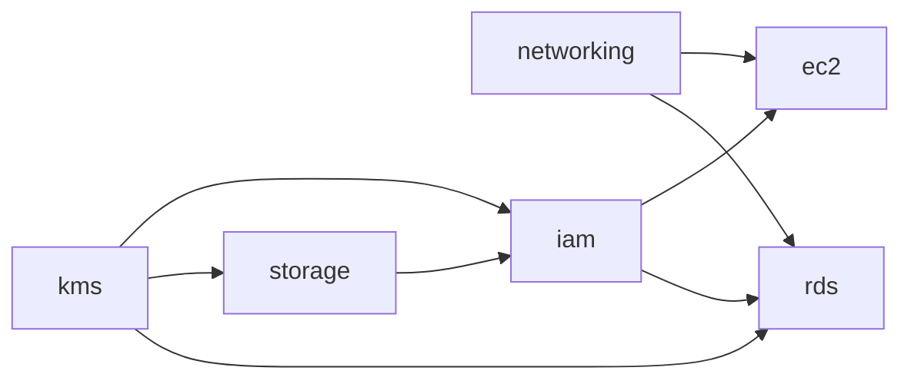

# Arquitetura

Este documento descreve **o que o código cria**, camada por camada. O **porquê** de cada escolha, as alternativas e os trade-offs estão em [DECISIONS.md](DECISIONS.md).

Tudo fica em uma conta AWS, na região **sa-east-1**, em 2 zonas de disponibilidade: **sa-east-1a** e **sa-east-1b**. Todo recurso recebe automaticamente as tags `Environment`, `Project`, `ManagedBy = Terraform`, `Owner` e `Repository` (bloco `default_tags` em `terraform/versions.tf`).

## Sumário

1. [Visão geral e dependências entre módulos](#1-visão-geral-e-dependências-entre-módulos)
2. [Rede (`networking`)](#2-rede-networking)
3. [Identidade e acesso (`iam`)](#3-identidade-e-acesso-iam)
4. [Chaves de criptografia (`kms`)](#4-chaves-de-criptografia-kms)
5. [Banco de dados (`rds`)](#5-banco-de-dados-rds)
6. [Aplicação: ALB e Auto Scaling (`ec2`)](#6-aplicação-alb-e-auto-scaling-ec2)
7. [Armazenamento (`storage`)](#7-armazenamento-storage)
8. [Segurança em camadas: resumo](#8-segurança-em-camadas-resumo)
9. [O que acontece quando uma AZ cai](#9-o-que-acontece-quando-uma-az-cai)

---

## 1. Visão geral e dependências entre módulos

O `terraform/main.tf` chama 6 módulos e passa as saídas de um como entrada de outro:

| Módulo | Recebe de | Entrega para |
|---|---|---|
| `networking` | — | IDs da VPC, das subnets e dos 3 security groups |
| `kms` | — | ARN da chave do banco (`rds`) e da chave do S3 (`storage`, `iam`) |
| `storage` | `kms` | ARNs dos 3 buckets (`iam`) |
| `iam` | `storage`, `kms` | Instance profile da EC2 (`ec2`) e role de monitoramento (`rds`) |
| `rds` | `networking`, `kms`, `iam` | Endpoints do banco e ARN do segredo |
| `ec2` | `networking`, `iam` | DNS do ALB e nome do ASG |

Não existe ciclo: o Terraform consegue ordenar a criação sozinho (`kms` → `storage` → `iam` → `rds`/`ec2`).

---

## 2. Rede (`networking`)

**18 recursos.** Arquivo: `terraform/modules/networking/main.tf`.

### VPC e subnets

| Recurso | CIDR | AZ | Função |
|---|---|---|---|
| VPC | `10.0.0.0/16` | — | Rede isolada do projeto, com DNS habilitado (`enable_dns_hostnames`, `enable_dns_support`) |
| Subnet pública 1 | `10.0.1.0/24` | sa-east-1a | ALB e NAT Gateway |
| Subnet pública 2 | `10.0.2.0/24` | sa-east-1b | ALB |
| Subnet privada 1 | `10.0.11.0/24` | sa-east-1a | EC2 e Aurora writer |
| Subnet privada 2 | `10.0.12.0/24` | sa-east-1b | EC2 e Aurora reader |

As subnets são criadas com `count = length(var.azs)`, então as listas de AZs e CIDRs precisam estar na mesma ordem. Nenhuma subnet dá IP público automático (`map_public_ip_on_launch = false`): o NAT usa o Elastic IP e o ALB cuida dos próprios IPs. Assim, uma instância lançada por engano numa subnet pública não fica exposta.

Padrão dos IPs: `10.0.1.x`/`10.0.2.x` são públicas, `10.0.11.x`/`10.0.12.x` são privadas. Só de olhar o IP dá para saber o tipo e a AZ da subnet.

### Saída para a internet

- **Internet Gateway (IGW):** porta de entrada e saída da VPC.
- **Route table pública:** rota `0.0.0.0/0 → IGW`, associada às 2 subnets públicas. É essa rota que torna uma subnet "pública".
- **NAT Gateway (um só)**, com Elastic IP, na subnet pública da **1a**. Permite que recursos privados iniciem conexões para fora (atualizar pacotes, falar com APIs da AWS), mas ninguém de fora consegue iniciar conexão com eles.
- **Route table privada (uma só)**: rota `0.0.0.0/0 → NAT`, associada às 2 subnets privadas.

Como o NAT é único, a subnet privada da 1b sai para a internet passando pelo NAT que está na 1a. Isso é uma escolha de custo, explicada em [DECISIONS.md](DECISIONS.md#1-rede).

### Security groups em cadeia

Um security group (SG) é um firewall *stateful* ligado a cada interface de rede: se uma conexão de entrada é permitida, a resposta sai automaticamente.

| SG | Entrada | Saída |
|---|---|---|
| `alb-sg` | TCP 80 e 443 de `0.0.0.0/0` | Só TCP 8000 para o CIDR da VPC |
| `app-sg` | Só TCP 8000 **vindo do `alb-sg`** | Tudo (`0.0.0.0/0`), para atualizações, APIs da AWS e banco |
| `rds-sg` | Só TCP 5432 **vindo do `app-sg`** | Nenhuma regra (o banco não inicia conexões) |

A cadeia é **internet → ALB → app → banco**. A regra de entrada da app e a do banco apontam para o **ID do security group** anterior, e não para uma faixa de IP. Assim, só quem está "dentro" do SG anterior passa, mesmo que mude de IP.

Hoje a porta 443 está aberta no `alb-sg`, mas não existe listener HTTPS no ALB. Ela foi deixada pronta para quando houver domínio e certificado.

Não há nenhuma regra para a porta 22 (SSH) em lugar nenhum.

O **SG default da VPC** é assumido pelo Terraform (`aws_default_security_group`) e fica **sem nenhuma regra**. Nada usa o default; se algum recurso for criado sem SG, ele cai no default e fica isolado em vez de aberto.

---

## 3. Identidade e acesso (`iam`)

**16 recursos.** Arquivo: `terraform/modules/iam/main.tf`.

Nenhum usuário IAM e nenhuma access key são criados. Cada serviço recebe uma **role**, que entrega credenciais temporárias via `sts:AssumeRole`. A *trust policy* de cada role diz qual serviço pode assumi-la.

### Role 1: EC2 (`seguros-horizonte-ec2-role`)

Assumida só por `ec2.amazonaws.com`. Chega às instâncias pelo **instance profile** `seguros-horizonte-ec2-profile`, referenciado no launch template.

| Policy | Ações | Recurso |
|---|---|---|
| `ec2-s3-access` (inline) | `s3:GetObject`, `PutObject`, `DeleteObject`, `ListBucket` | ARNs exatos dos 3 buckets e `bucket/*` |
| `ec2-kms-s3` (inline) | `kms:Decrypt`, `GenerateDataKey`, `DescribeKey` | ARN exato da chave do S3, só com `kms:ViaService = s3.sa-east-1.amazonaws.com` |
| `ec2-db-secret` (inline) | `secretsmanager:GetSecretValue` | Segredos `rds!cluster-*` desta conta e região |
| `ec2-rds-access` (inline) | `rds:DescribeDBInstances`, `DescribeDBClusters` | `cluster:seguros-horizonte-*` e `db:seguros-horizonte-*` |
| `ec2-cloudwatch-logs` (inline) | Criar grupo/stream de log, enviar eventos | `log-group:/aws/ec2/*` desta conta e região |
| `AmazonSSMManagedInstanceCore` (gerenciada pela AWS) | Agente do Systems Manager | — |

### Role 2: RDS Enhanced Monitoring

Assumida só por `monitoring.rds.amazonaws.com`. Usa a policy gerenciada `AmazonRDSEnhancedMonitoringRole`. O Aurora usa essa role para enviar as métricas do sistema operacional das instâncias (a cada 60 s) para o CloudWatch.

### Role 3: Lambda

Assumida só por `lambda.amazonaws.com`. Foi preparada para uma função futura que processe arquivos do S3; **nenhuma função Lambda é criada neste case**.

| Policy | Ações | Recurso |
|---|---|---|
| `lambda-s3-access` | `GetObject`, `PutObject`, `ListBucket` (sem `DeleteObject`) | ARNs exatos dos 3 buckets |
| `lambda-kms-s3` | Igual à da EC2 | Chave do S3, só via S3 |
| `lambda-rds-access` | `DescribeDBInstances`, `DescribeDBClusters` | Recursos `seguros-horizonte-*` |
| `lambda-cloudwatch-logs` | Escrever logs | `log-group:/aws/lambda/*` |
| `AWSLambdaVPCAccessExecutionRole` (gerenciada) | Criar interfaces de rede na VPC | — |

### Permissões que ficaram de fora de propósito

- Nenhuma role tem permissão na **chave KMS do banco**. Quem usa essa chave é o próprio serviço RDS, por meio de *grants* (ver seção 4).
- Nenhuma policy do projeto usa `Resource = "*"`.

---

## 4. Chaves de criptografia (`kms`)

**4 recursos.** Arquivo: `terraform/modules/kms/main.tf`.

| Chave | Alias | Usada por |
|---|---|---|
| Chave do banco | `alias/seguros-horizonte-rds` | Storage do Aurora e Performance Insights |
| Chave do S3 | `alias/seguros-horizonte-s3` | Os 3 buckets |

As duas são *customer managed keys* (CMKs), com **rotação automática anual** (`enable_key_rotation = true`) e **janela de exclusão de 30 dias** (o máximo; uma validação no código só aceita valores entre 7 e 30).

### Key policy: quem administra é diferente de quem usa

Cada chave tem uma *key policy* própria, com declarações separadas:

1. **`KeyAdministration`**: a conta (via IAM) pode ver, habilitar, desabilitar, rotacionar, mudar a policy, gerenciar tags e agendar a exclusão da chave. Essa declaração **não inclui** `Encrypt`, `Decrypt` nem `CreateGrant`. Manter a conta como administradora evita uma chave "órfã", que ninguém mais consegue gerenciar.
2. **`UseOnlyThroughRDS`** / **`UseOnlyThroughS3`**: `Encrypt`, `Decrypt`, `ReEncrypt*`, `GenerateDataKey*` e `DescribeKey` só valem quando a chamada **passa pelo serviço dono** da chave (`kms:ViaService`) e vem **desta conta** (`kms:CallerAccount`).
3. **`AllowRDSGrants`** (só na chave do banco): o RDS pode criar *grants* (autorizações temporárias para usar a chave em segundo plano, como em backups e réplicas), mas só via RDS e só para recursos da AWS (`kms:GrantIsForAWSResource = true`), nunca para uma pessoa.

Efeito prático: mesmo um usuário com `kms:Decrypt` no IAM não consegue descriptografar nada chamando o KMS diretamente. A chave do banco só funciona através do RDS, e a do S3, só através do S3.

---

## 5. Banco de dados (`rds`)

**5 recursos.** Arquivo: `terraform/modules/rds/main.tf`.

| Item | Configuração |
|---|---|
| Motor | Aurora PostgreSQL, família 15. A versão é fixa (`15.19`, variável `engine_version` do módulo, conferida com `aws rds describe-db-engine-versions`) e fica em `ignore_changes` para não brigar com upgrades menores automáticos. O data source `aws_rds_orderable_db_instance` confere no plan se a classe `db.t3.medium` pode ser criada com essa versão em sa-east-1 |
| Banco / usuário | `segurosdb` / `postgresadmin` |
| Senha | `manage_master_user_password = true`: a AWS gera a senha e guarda no **Secrets Manager**. Não existe senha no código nem no state |
| Instâncias | 2 × `db.t3.medium`: **writer** fixado em sa-east-1a e **reader** em sa-east-1b, com `promotion_tier = 1` |
| Rede | *Subnet group* com as 2 subnets privadas, `publicly_accessible = false`, SG `rds-sg` |
| Criptografia | `storage_encrypted = true` com a chave do banco; Performance Insights criptografado com a mesma chave |
| Backup | Retenção de 7 dias, janela 03:00–04:00 UTC (meia-noite em São Paulo). Manutenção no domingo 05:00–06:00 UTC |
| Logs | Log do PostgreSQL exportado para o CloudWatch. O parameter group registra só comandos DDL (`log_statement = ddl`) e consultas acima de 1 s (`log_min_duration_statement = 1000`) |
| Monitoramento | Enhanced Monitoring a cada 60 s (role do módulo IAM) e Performance Insights ligado |
| Autenticação IAM | `iam_database_authentication_enabled = true` está ligado, mas nenhuma role tem `rds-db:connect`. Na prática, a app entra com usuário e senha |
| Proteções de exclusão | `deletion_protection = false` e `skip_final_snapshot = true` (projeto de estudo; em produção seria o contrário) |

### Como funciona o Aurora aqui

O Aurora separa computação de armazenamento. O **volume de dados** é gerenciado pela AWS e replicado em 3 AZs, independentemente de quantas instâncias existam. As **instâncias** são só a parte de processamento:

- O **writer** (1a) recebe leituras e escritas pelo *cluster endpoint* (output `db_cluster_endpoint`).
- O **reader** (1b) recebe só leituras pelo *reader endpoint* (output `db_reader_endpoint`).
- Se o writer falhar, o Aurora promove o reader a writer, e o *cluster endpoint* passa a apontar para ele.

### Como a aplicação pega a senha

1. A instância EC2 usa a role dela (credenciais temporárias via instance profile).
2. Chama `secretsmanager:GetSecretValue` no segredo `rds!cluster-...` (permitido pela policy `ec2-db-secret`).
3. Conecta no *cluster endpoint* na porta 5432, o que o `rds-sg` permite porque a instância está no `app-sg`.

O segredo é criptografado com a chave gerenciada da AWS `aws/secretsmanager`, e não com a chave do banco.

---

## 6. Aplicação: ALB e Auto Scaling (`ec2`)

**9 recursos.** Arquivo: `terraform/modules/ec2/main.tf`.

### Application Load Balancer

- ALB **público** (`internal = false`) nas 2 subnets públicas, com o `alb-sg`.
- `drop_invalid_header_fields = true`: descarta cabeçalhos HTTP malformados (proteção contra *request smuggling*).
- **Listener HTTP:80** que encaminha tudo para o target group. Não existe listener HTTPS.
- **Target group** na porta 8000, protocolo HTTP. Health check em `/health`, esperando `200`, a cada 30 s; 2 falhas seguidas marcam a instância como doente, e 2 sucessos, como saudável.

### Launch template (a "receita" de cada instância)

| Item | Configuração |
|---|---|
| Imagem | Amazon Linux 2023 mais recente (`data "aws_ami"`, dona `amazon`, x86_64) |
| Tipo | `t3.small` |
| Permissões | Instance profile da role EC2 |
| Rede | SG `app-sg`, sem IP público (as subnets privadas não atribuem IP público) |
| Metadados | **IMDSv2 obrigatório** (`http_tokens = required`), `hop_limit = 1` |
| Disco | 20 GB gp3, **criptografado** (chave gerenciada `aws/ebs`), apagado junto com a instância |
| Monitoramento | Métricas detalhadas (1 em 1 minuto) |
| Acesso | Sem par de chaves SSH. Acesso pelo SSM Session Manager |

O `user_data.sh` roda na primeira inicialização: atualiza o sistema com `dnf`, instala Python 3 e o CloudWatch Agent, cria um servidor HTTP mínimo na porta 8000 que responde `OK` em `/health` e o registra como serviço do systemd. O CloudWatch Agent é instalado, mas não é configurado.

### Auto Scaling Group

- Nas **2 subnets privadas**, registrado no target group.
- **Mínimo 2, desejado 2, máximo 4.** Uma validação no código impede mínimo menor que 2.
- `health_check_type = "ELB"`: se o ALB marcar a instância como doente, o ASG a substitui. Há uma carência de 300 s para o `user_data` terminar.
- `create_before_destroy` no launch template, no target group e no ASG: numa mudança, o novo sobe antes de o antigo ser removido.

### Escala por CPU

| Alarme | Condição | Ação |
|---|---|---|
| `cpu-high` | CPU média > 70% por 2 períodos de 5 min | Política `scale-up`: +1 instância (cooldown 300 s) |
| `cpu-low` | CPU média < 30% por 2 períodos de 5 min | Política `scale-down`: −1 instância (cooldown 300 s) |

O ASG nunca passa de 4 nem cai abaixo de 2, mesmo que os alarmes continuem disparando.

---

## 7. Armazenamento (`storage`)

**17 recursos.** Arquivo: `terraform/modules/storage/main.tf`.

| Bucket | Versionamento | Lifecycle |
|---|---|---|
| `seguros-horizonte-app-data-<sufixo>` | Sim | Versões antigas vão para o Glacier em 90 dias e expiram em 2555 dias (7 anos) |
| `seguros-horizonte-backups-<sufixo>` | Sim | Objetos expiram em 30 dias; versões antigas, em 7 dias |
| `seguros-horizonte-logs-<sufixo>` | Não | Objetos vão para o Glacier em 90 dias e expiram em 2555 dias (7 anos) |

Os nomes usam `bucket_prefix`: o Terraform acrescenta um sufixo aleatório, porque nomes de bucket são únicos no mundo inteiro. Os nomes reais aparecem nos outputs.

Em comum nos 3 buckets:

- **Bloqueio de acesso público** com as 4 travas ligadas (`block_public_acls`, `block_public_policy`, `ignore_public_acls`, `restrict_public_buckets`).
- **Criptografia padrão SSE-KMS** com a chave do S3 e `bucket_key_enabled = true` (o S3 gera uma chave intermediária por bucket e chama o KMS bem menos vezes).
- **Bucket policy que nega qualquer acesso sem TLS** (`Deny` em `s3:*` quando `aws:SecureTransport = false`). Como um `Deny` explícito sempre vence um `Allow`, nem quem tem permissão no IAM acessa por HTTP.
- Uploads em partes (*multipart*) incompletos são apagados em 7 dias.

Hoje nenhum recurso do case grava nos buckets `backups` e `logs` automaticamente: eles estão prontos para uso, mas a integração (exportar dumps, logs de acesso etc.) não foi feita. Os backups do Aurora são os automáticos do próprio serviço (seção 5), e não ficam nesses buckets.

---

## 8. Segurança em camadas: resumo

| Camada | Controle | Onde está |
|---|---|---|
| Rede | Banco e EC2 em subnets privadas, sem rota de entrada pela internet | `networking` |
| Rede | Security groups em cadeia (ALB → app → banco), sem SSH | `networking` |
| Identidade | Roles com credenciais temporárias, nenhuma access key | `iam` |
| Identidade | Policies com ARNs exatos ou restritos ao projeto, nenhum `Resource = "*"` | `iam` |
| Criptografia em repouso | Aurora e Performance Insights com CMK própria | `kms`, `rds` |
| Criptografia em repouso | Buckets com SSE-KMS (CMK própria) | `kms`, `storage` |
| Criptografia em repouso | Discos EBS criptografados (`aws/ebs`) | `ec2` |
| Criptografia em trânsito | S3 nega acesso sem TLS | `storage` |
| Segredos | Senha do banco gerada e guardada pelo Secrets Manager | `rds` |
| Instância | IMDSv2 obrigatório, acesso por SSM | `ec2`, `iam` |
| Exposição | Block Public Access nos buckets; `publicly_accessible = false` no banco | `storage`, `rds` |

O que **ainda não** está coberto (HTTPS no ALB, WAF, logs de auditoria etc.) está em [DECISIONS.md › Pendências conhecidas](DECISIONS.md#pendências-conhecidas).

---

## 9. O que acontece quando uma AZ cai

| Cenário | ALB e EC2 | Aurora | Saída para a internet |
|---|---|---|---|
| **Cai a sa-east-1b** | O ALB para de mandar tráfego para a 1b. A instância da 1a continua atendendo, e o ASG tenta repor a capacidade. | O writer está na 1a: nada muda para escrita. Leituras pelo reader endpoint ficam sem réplica até ela voltar. | Continua funcionando (o NAT está na 1a). |
| **Cai a sa-east-1a** | O ALB usa só a 1b, e a instância de lá continua atendendo. | O reader da 1b é promovido a writer (failover automático, normalmente em menos de um minuto). | **Para.** O único NAT estava na 1a. As instâncias da 1b continuam recebendo e respondendo requisições do ALB, mas não conseguem iniciar conexões para fora (atualizações, SSM, S3 e Secrets Manager pelos endpoints públicos). |

O segundo cenário é o ponto fraco consciente do projeto. A correção (um NAT por AZ ou VPC endpoints) está em [DECISIONS.md](DECISIONS.md#pendências-conhecidas).
